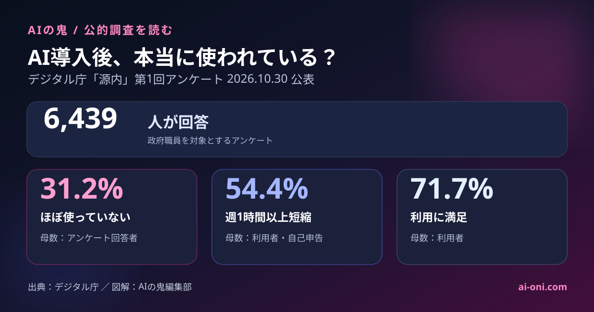
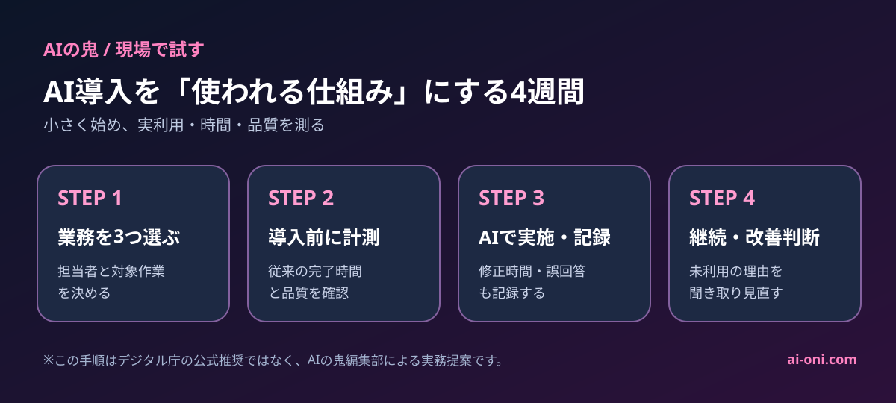

生成AIを会社に導入した。それなのに、実際に使っているのは一部の人だけ——。こんな状態を避けたい経営者に、参考になる公的調査が出ました。

2026年10月30日、デジタル庁は政府職員向け生成AI「ガバメントAI 源内（げんない）」の第1回利用状況アンケートを公表しました。**6,439人が回答**し、AIを使っている人に効果がある一方で、**回答者の31.2%は「ほとんど、または全く利用していない」**ことが分かりました。

ただし、ここで言う「3割」は**アンケートに回答した政府職員の割合**です。日本の会社員全体や全国の中小企業の利用率を示す数字ではありません。

*図解：AIの鬼編集部。数字はデジタル庁公表値。満足度・時間短縮は利用者、未利用割合はアンケート回答者を母数としています。*

## 調査で分かった4つの数字

| 見るべき数字 | 結果 | 何を意味するか |
|---|---:|---|
| アンケート回答者 | 6,439人 | 政府職員を対象とする調査の回答数 |
| 週1時間以上の短縮を実感 | 利用者の54.4% | 利用した人の自己申告による効果 |
| 利用者の満足度 | 71.7% | 源内に「満足」と答えた利用者の割合 |
| ほとんど・全く使っていない | 回答者の31.2% | 利用が定着していない層も存在する |

また、デジタル庁は利用者1人当たりの短縮時間を**週平均1.83時間**と推計しています。これは申告された時間幅の中央値などを用いた計算であり、全利用者の業務ログを計測した実測値ではありません。

出典：[デジタル庁「ガバメントAI 源内 利用状況アンケート調査（第1回）の結果を公表しました」（2026年10月30日）](https://www.digital.go.jp/policies/genai/f9ed1b1c-b22f-4466-8e50-c1c9adf9f8eb)

## 「使えない」と「使わない」は違う

報告では、利用が進まない理由として、具体的な使い方が分からないこと、業務で必要性を感じないこと、別のAIを使っていることなどが挙げられています。利用者からも、回答の精度や信頼性に関する不満が寄せられました。自社で原因を切り分ける手順は、[導入したAIツールが使われない — 実行0通・承認待ちが増えた自社の記録と、原因の切り分け方](/articles/ai-tool-not-adopted/)でも整理しています。

中小企業でありがちなのは、「全社員にアカウントを配ればAI導入は完了」と考えてしまうことです。しかし、**契約人数と実際に仕事に使っている人数は別の指標**です。

AIが得意な業務が見つからない社員に、操作方法だけを教えても利用は増えにくいでしょう。逆に、見積書の下書きや議事録の要約など、今ある仕事での使い道が具体的なら、効果を確かめやすくなります。

## 中小企業が測るべきは「導入率」より4つの指標

### 1．実利用率

契約アカウント数ではなく、直近1週間に業務で利用した人数を把握します。利用できない理由も聞き取ります。

### 2．業務ごとの作業時間

議事録作成、社内文書検索、問い合わせメールの下書きなど、対象を**まず3業務**に絞ります。AIを使わない場合の所要時間を先に測り、導入後と比較します。

### 3．確認・修正時間

AIが下書きを5分で作っても、誤りの確認と修正に20分かかれば意味がありません。「生成までの時間」ではなく**人の確認を含めた完了時間**を計測します。

### 4．品質と安全性

誤回答、機密情報の入力、根拠不明の記述などの有無を点検します。使い方が分からない人への研修だけでなく、利用している人が安全に使える手順も必要です。

## 製造業なら、どの業務から試す？

AI専任者がいない製造業なら、最初から生産管理システムと連携させる必要はありません。

例えば、**現場日報の要約**、**設備トラブル記録からの類似事例検索**、**顧客問い合わせへの回答案作成**の3つです。業務が定型的で、従来の作業時間とAIを使った作業時間を比較しやすいからです。

ただし、設備停止の判断や品質保証の確定など、誤りの影響が大きい業務は、現場責任者の確認を残すべきです。

## まず4週間、10人程度で試す

実務導入の第一歩として、次のような小規模テストを推奨します。

1. **開始前：** 対象業務3つと、評価責任者を決める。
2. **第1週：** 使わない場合の作業時間を測り、機密情報の入力ルールを決める。
3. **第2〜3週：** 業務ごとにAIを使い、作業時間・修正時間・正確性を記録する。
4. **第4週：** 利用者と未利用者の声を聞き、継続する業務・やめる業務・研修が必要な業務を分ける。

対象者が10人程度の社内検証では、統計的に一般化できる結果にはなりません。それでも、**自社で何が役に立ち、何が定着を妨げるのか**を見つけるには有効な出発点です。

## 調査から言えること／言えないこと

**確認できること：** 源内のアンケート回答者のなかで、AI利用者は時間短縮を実感している一方、ほとんど利用していない回答者もいること。

**まだ言えないこと：** 「AIを導入すると全社員の業務時間が週1.83時間減る」「日本の中小企業でも31.2%が使わない」「研修だけで利用率が上がる」といった因果関係や一般化です。公表資料は主に自己申告の調査であり、比較対照群を置いた実験ではありません。

デジタル庁は今回の結果を受けて、利用事例やプロンプトの共有、基本研修、回答の根拠を確認しやすくする仕組みなどの改善を進める方針です。

## 結論：AIを入れるより、仕事に根付かせる

AI導入の目的は、アカウントを配ることではありません。仕事が早く、正確になり、現場の負担が減ることです。

今回の6,439人調査は、利用している人とそうでない人に差があることを示しています。中小企業が学べるのは、**まず業務を絞り、実際の利用と完了時間を測り、研修や運用を見直す**という進め方です。

---

**一次資料**：デジタル庁「[ガバメントAI 源内 利用状況アンケート調査（第1回）の結果を公表しました](https://www.digital.go.jp/policies/genai/f9ed1b1c-b22f-4466-8e50-c1c9adf9f8eb)」（2026年10月30日公表、調査実施は2026年8月21日〜9月18日）。

*本記事は公表資料の内容と、AIの鬼編集部による中小企業向けの実務提案を分けて記述しました。掲載した図は編集部作成のイメージ・図解であり、デジタル庁が制作したものではありません。*
